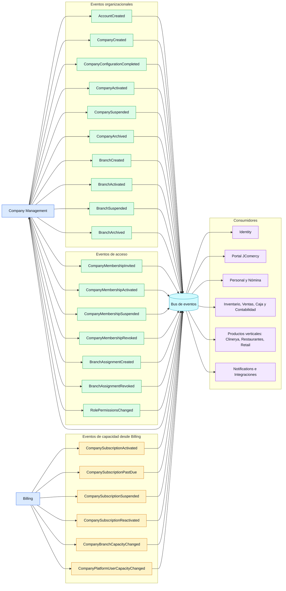
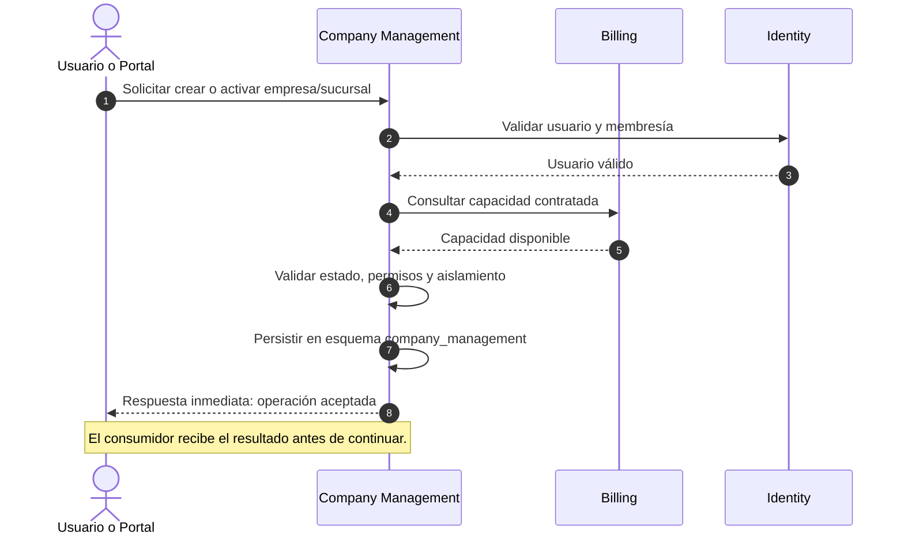
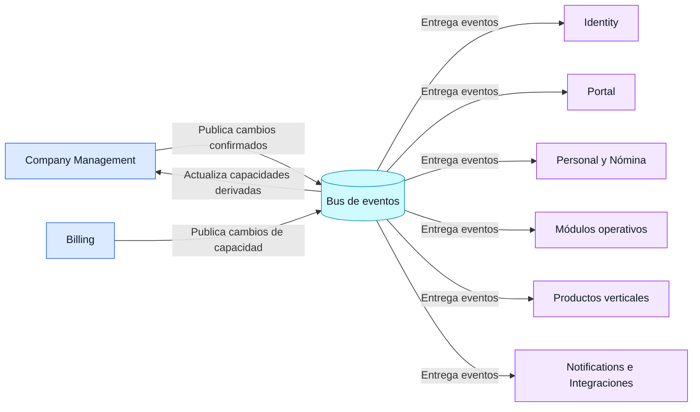

# Contratos entre módulos: Company Management

## 1. Alcance

Este documento define los contratos síncronos y asíncronos mediante los cuales otros módulos colaborarán con `company_management`.

Los contratos son la única vía permitida para consultar o notificar información del módulo. Ningún consumidor podrá acceder directamente a sus tablas o esquema.

## 2. Principios

- `company_management` es el propietario de cuentas, empresas, sucursales, membresías, asignaciones, roles y permisos empresariales.
- Cada módulo conserva la propiedad de sus propios datos.
- Las consultas síncronas se utilizarán cuando el consumidor necesite una respuesta inmediata.
- Los eventos asíncronos se utilizarán para comunicar cambios ya confirmados.
- Los identificadores públicos serán los identificadores de integración.
- Los contratos no expondrán información innecesaria o sensible.
- Las operaciones deberán validar contexto de cuenta, empresa, sucursal y usuario.
- Todos los eventos deberán ser idempotentes para permitir reintentos.

## 3. Consumidores principales

| Consumidor | Necesidad |
|---|---|
| Identity | Validar identidad y estado del usuario. |
| Billing | Validar empresa y notificar capacidades contratadas. |
| Personal y Nómina | Relacionar empleados con usuarios y empresas. |
| Inventario | Validar empresa, sucursal y permisos de operación. |
| Ventas | Validar contexto de venta y permisos. |
| Caja | Validar sucursal y autorización para operar caja. |
| Contabilidad | Recibir contexto empresarial y eventos operativos. |
| Fiscal | Consultar configuración empresarial necesaria para cumplimiento. |
| Clinerya | Validar empresa, sucursal y membresías para operaciones clínicas. |
| Portal del empleado | Consultar asignaciones y permisos limitados. |

## 4. Contratos síncronos de consulta

### 4.1 Resolver empresa

**Objetivo:** obtener el contexto básico de una empresa sin exponer sus tablas.

Entrada conceptual:

```text
publicCompanyId
requestingUserId
requestedScope
```

Respuesta conceptual:

```text
publicCompanyId
accountPublicId
legalName
commercialName
status
configurationStatus
timezone
currency
```

Reglas:

- El módulo valida que el usuario tenga acceso a la empresa.
- No devuelve información de otras empresas de la misma cuenta sin autorización.
- Una empresa `ARCHIVED` solo puede consultarse con permiso histórico.

### 4.2 Resolver sucursal

**Objetivo:** validar que una sucursal pertenece a una empresa y que puede utilizarse en una operación.

Entrada conceptual:

```text
publicCompanyId
publicBranchId
requestingUserId
operation
```

Respuesta conceptual:

```text
publicCompanyId
publicBranchId
name
code
status
isHeadquarters
timezone
canOperate
```

`canOperate` no reemplaza las reglas del módulo consumidor; solo indica si el contexto empresarial y de sucursal es válido.

### 4.3 Resolver autorización

**Objetivo:** determinar si un usuario puede ejecutar una acción dentro de una empresa o sucursal.

Entrada conceptual:

```text
userId
publicCompanyId
publicBranchId
moduleCode
permissionCode
accessMode
```

Respuesta conceptual:

```text
allowed
scope
reason
matchedRoles
```

El consumidor debe tratar `allowed = false` como una denegación. No podrá inferir permisos por conocer el identificador público.

### 4.4 Resolver asignación de usuario

**Objetivo:** validar si un usuario está asignado a una sucursal.

Entrada conceptual:

```text
userId
publicCompanyId
publicBranchId
```

Respuesta conceptual:

```text
membershipStatus
assignmentStatus
isPrimaryBranch
```

La asignación es necesaria para operar en la sucursal, salvo que exista un permiso global explícito.

### 4.5 Validar empresa para Billing

**Objetivo:** permitir que Billing confirme que la empresa existe y puede contratar una suscripción.

Billing podrá solicitar:

```text
publicCompanyId
accountPublicId
status
configurationStatus
```

El contrato no permitirá que Billing modifique empresa, sucursal o membresías directamente.

### 4.6 Consultar capacidades administrativas

**Objetivo:** permitir que el Portal conozca el estado derivado de la empresa.

La respuesta podrá incluir:

```text
companyStatus
subscriptionStatus
branchCapacity
activeBranchCount
platformUserCapacity
activePlatformUserCount
enabledModules
```

Los valores de suscripción, capacidad y consumo serán proporcionados por Billing. `company_management` solo expondrá su propio contexto organizacional.

## 5. Comandos síncronos

Los comandos que modifican datos deberán ejecutarse dentro del módulo propietario:

| Comando | Propietario | Resultado |
|---|---|---|
| Crear empresa | Company Management | Empresa en `CONFIGURING`. |
| Completar empresa | Company Management | Empresa lista para activación. |
| Crear sucursal | Company Management | Sucursal en `CONFIGURING`. |
| Activar sucursal | Company Management + Billing | Sucursal activa si existe capacidad. |
| Invitar miembro | Company Management + Identity | Membresía pendiente. |
| Asignar sucursal | Company Management | Asignación activa o pendiente. |
| Crear rol personalizado | Company Management | Rol limitado a una empresa. |
| Suspender empresa | Company Management | Operación restringida. |

Un módulo externo podrá solicitar un comando, pero no ejecutará la escritura directamente.

## 6. Eventos publicados

### 6.1 Eventos organizacionales

| Evento | Cuándo se publica |
|---|---|
| `AccountCreated` | Se crea una cuenta administrativa. |
| `CompanyCreated` | Se registra una empresa. |
| `CompanyConfigurationCompleted` | Se completan datos obligatorios. |
| `CompanyActivated` | La empresa puede operar. |
| `CompanySuspended` | La empresa queda restringida. |
| `CompanyArchived` | La empresa deja de operar y conserva histórico. |
| `BranchCreated` | Se registra una sucursal. |
| `BranchActivated` | Una sucursal queda operativa. |
| `BranchSuspended` | Una sucursal queda restringida. |
| `BranchArchived` | Una sucursal se archiva. |

### 6.2 Eventos de acceso

| Evento | Cuándo se publica |
|---|---|
| `CompanyMembershipInvited` | Se invita un usuario a una empresa. |
| `CompanyMembershipActivated` | El usuario acepta y queda activo. |
| `CompanyMembershipSuspended` | Se suspende temporalmente el acceso. |
| `CompanyMembershipRevoked` | Se revoca la membresía. |
| `BranchAssignmentCreated` | Se asigna un usuario a una sucursal. |
| `BranchAssignmentRevoked` | Se retira la asignación. |
| `RolePermissionsChanged` | Cambia el conjunto de permisos de un rol. |

### 6.3 Eventos de capacidad

Billing publicará eventos que `company_management` consumirá:

| Evento externo | Efecto esperado |
|---|---|
| `CompanySubscriptionActivated` | Habilitar operación según capacidades. |
| `CompanySubscriptionPastDue` | Iniciar periodo de gracia. |
| `CompanySubscriptionSuspended` | Restringir nuevas operaciones. |
| `CompanySubscriptionReactivated` | Restaurar capacidades permitidas. |
| `CompanyBranchCapacityChanged` | Recalcular sucursales activables. |
| `CompanyPlatformUserCapacityChanged` | Recalcular usuarios de plataforma permitidos. |

## 6.4 Diagrama de eventos del módulo



El diagrama distingue tres responsabilidades: `Company Management` publica cambios organizacionales y de acceso, `Billing` publica cambios de capacidad, y los demás módulos consumen eventos sin acceder directamente a las tablas propietarias.

## 6.5 Enrutamiento: API síncrona frente a bus de eventos

Los módulos no deben elegir entre REST y eventos para la misma intención. La regla será:

```text
Consulta o comando que requiere respuesta inmediata → API/contrato síncrono
Cambio confirmado que otros módulos deben conocer → evento en el bus
```

### Operaciones por API REST o contrato síncrono

Estas operaciones necesitan una respuesta inmediata para que el Portal o el módulo consumidor pueda continuar:

| Operación | Consumidor o iniciador |
|---|---|
| Resolver empresa | Portal, Billing y módulos operativos |
| Resolver sucursal | Portal y módulos operativos |
| Validar autorización | Portal y módulos operativos |
| Validar asignación a sucursal | Portal y módulos operativos |
| Crear o completar empresa | Portal |
| Crear o activar sucursal | Portal, sujeto a validación de Billing |
| Invitar miembro | Portal |
| Asignar miembro a sucursal | Portal o administrador autorizado |
| Crear rol personalizado | Administrador autorizado |
| Consultar capacidades vigentes | Portal y módulos autorizados |

REST será el contrato de entrada para clientes externos, como el Portal Web o una aplicación móvil. Entre módulos que compartan el mismo despliegue se preferirá una interfaz de aplicación interna; si posteriormente se separan como servicios, podrá exponerse mediante REST.

### Operaciones por bus de eventos

Todos los eventos del diagrama pasan por el bus, agrupados así:

| Grupo | Eventos |
|---|---|
| Organizacionales | `AccountCreated`, `CompanyCreated`, `CompanyConfigurationCompleted`, `CompanyActivated`, `CompanySuspended`, `CompanyArchived`, `BranchCreated`, `BranchActivated`, `BranchSuspended`, `BranchArchived` |
| Acceso | `CompanyMembershipInvited`, `CompanyMembershipActivated`, `CompanyMembershipSuspended`, `CompanyMembershipRevoked`, `BranchAssignmentCreated`, `BranchAssignmentRevoked`, `RolePermissionsChanged` |
| Capacidad de Billing | `CompanySubscriptionActivated`, `CompanySubscriptionPastDue`, `CompanySubscriptionSuspended`, `CompanySubscriptionReactivated`, `CompanyBranchCapacityChanged`, `CompanyPlatformUserCapacityChanged` |

Estos eventos se publican después de que el módulo propietario confirme y persista el cambio. Los consumidores los procesan de forma asíncrona para actualizar sus propias proyecciones, activar reglas o iniciar procesos secundarios.

### Ejemplo: creación de una sucursal

```text
Portal → API Company Management: solicitar creación
Company Management → Billing: validar capacidad, síncrono
Company Management → esquema propio: guardar sucursal
Company Management → Bus: publicar BranchCreated
Bus → Inventario, Ventas, Caja, Clinerya: procesar evento
API Company Management → Portal: responder sucursal creada
```

La respuesta REST confirma la operación solicitada; el evento comunica el cambio al resto del ecosistema. Ningún módulo consumidor necesita consultar directamente la tabla `branch`.

## 6.6 Diagramas separados de comunicación

### 6.6.1 Flujo síncrono: API y contratos inmediatos



### 6.6.2 Flujo asíncrono: publicación y consumo de eventos



En el flujo síncrono se espera una respuesta inmediata. En el flujo asíncrono, el productor confirma primero su propia transacción y después publica el evento; los consumidores pueden procesarlo posteriormente y deben soportar reintentos e idempotencia.

## 7. Estructura común de eventos

Todos los eventos deberán incluir conceptualmente:

```text
eventId
eventType
eventVersion
occurredAt
producerModule
correlationId
causationId
accountPublicId
companyPublicId
branchPublicId (opcional)
actorPublicUserId (opcional)
payload
```

El `eventId` permitirá deduplicar mensajes. `eventVersion` permitirá evolucionar el contrato sin romper consumidores existentes.

## 8. Errores contractuales

Los contratos deberán distinguir al menos:

- `NOT_FOUND`: entidad inexistente o no visible para el solicitante.
- `UNAUTHORIZED`: usuario no autenticado.
- `FORBIDDEN`: usuario autenticado sin permiso.
- `INVALID_SCOPE`: empresa o sucursal fuera del alcance.
- `INVALID_STATE`: entidad en estado incompatible con la operación.
- `CAPACITY_EXCEEDED`: límite de Billing alcanzado.
- `CONFLICT`: operación duplicada o estado concurrente.
- `TEMPORARILY_UNAVAILABLE`: dependencia no disponible.

No se debe revelar si existe una entidad de otra empresa cuando el solicitante no tiene autorización para verla.

## 9. Versionado y evolución

- Los contratos deberán versionarse desde su primera publicación.
- Los cambios compatibles podrán agregarse como campos opcionales.
- Los cambios incompatibles requerirán una nueva versión.
- Los eventos antiguos deberán conservarse durante el periodo definido de compatibilidad.
- Ningún consumidor podrá depender de columnas internas o nombres de tablas.

## 10. Aprobación

**Estado: APROBADO por el propietario del proyecto.**

El plan de comunicación síncrona y asíncrona queda aprobado como base para definir las interfaces de aplicación, APIs internas y eventos del módulo `company_management`.

Esta aprobación no autoriza todavía la implementación de código ni la creación de scripts SQL. El siguiente paso será planificar las migraciones Flyway del esquema propietario.
