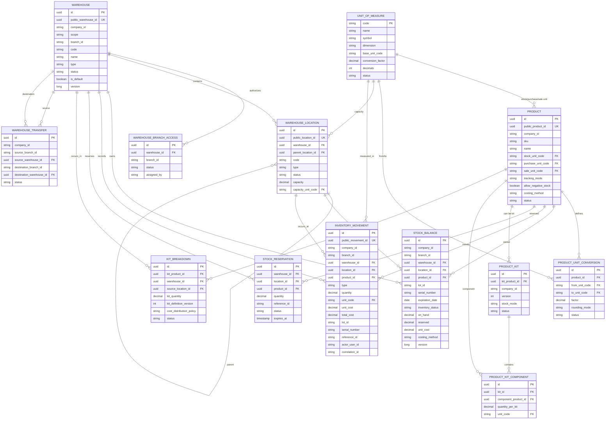
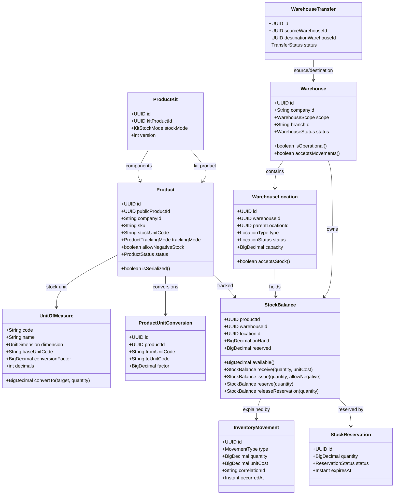
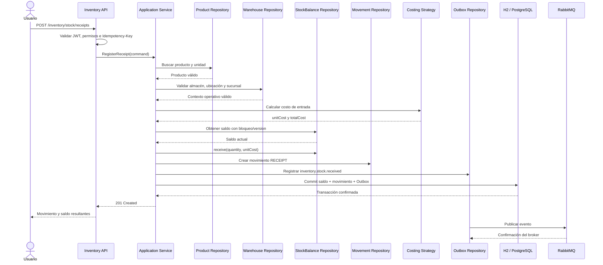
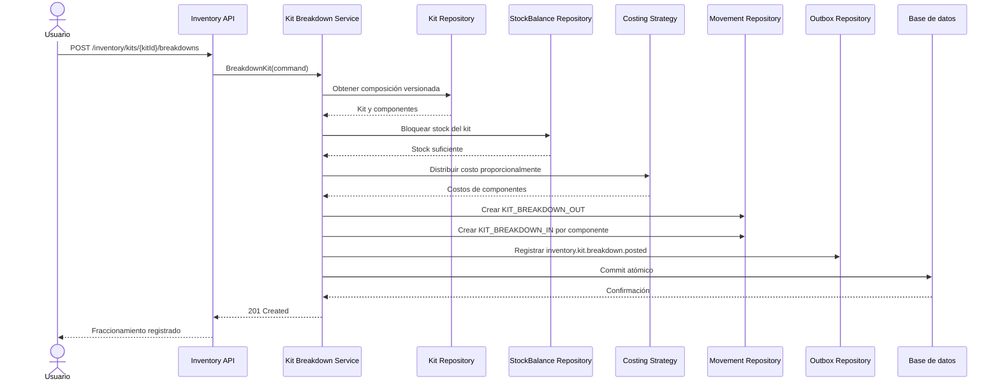
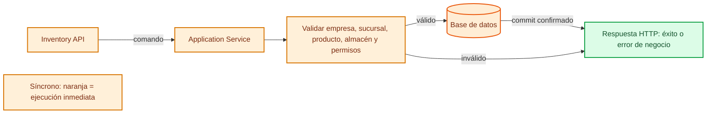
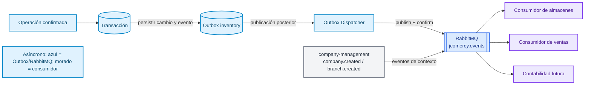

# Diagramas del módulo Inventory / Warehouses

> Diagramas de referencia para ubicar la estructura actual y el flujo objetivo del módulo.

## Estado de implementación

### Ya creadas en H2

- `unit_of_measure`
- `product`
- `product_unit_conversion`
- `warehouse`
- `warehouse_branch_access`
- `warehouse_location`
- `stock_balance`
- `inventory_movement`

### Pendientes del modelo objetivo

- Reservas.
- Transferencias.
- Kits y fraccionamiento.
- Políticas de valuación.
- Outbox específico del módulo.

## 1. Mapa entidad-relación

El siguiente mapa representa las tablas del modelo objetivo. `company-management` y sus entidades no se relacionan mediante claves foráneas; sus identificadores son referencias públicas externas.

## 2. Mapa UML del dominio

Este diagrama muestra los agregados y objetos principales, no las clases JPA.

## 3. Secuencia: registrar una entrada de inventario

Este es el flujo objetivo cuando un usuario registra mercancía recibida.

## 4. Secuencia: fraccionar un kit

## 5. Diagrama de eventos síncronos

Los eventos síncronos forman parte de la operación actual. El emisor espera la respuesta del consumidor antes de completar el flujo. Se muestran en naranja.

Ejemplos: registrar un producto, crear o activar un almacén, registrar una entrada/salida/ajuste, crear una reserva, recibir una transferencia o fraccionar un kit.

## 6. Diagrama de eventos asíncronos

Los eventos asíncronos se persisten en Outbox dentro de la transacción y se publican posteriormente en RabbitMQ. Se muestran en azul; los consumidores pueden procesarlos sin bloquear la respuesta HTTP.

### Eventos publicados por Inventory

| Evento | Productor | Consumidores previstos |
|---|---|---|
| `warehouse.created` | Inventory | Almacenes, auditoría |
| `warehouse.activated` | Inventory | Almacenes, módulos contratados |
| `inventory.stock.received` | Inventory | Compras, contabilidad, reportes |
| `inventory.stock.issued` | Inventory | Ventas, contabilidad, reportes |
| `inventory.stock.adjusted` | Inventory | Auditoría, contabilidad |
| `inventory.stock.reserved` | Inventory | Ventas, pedidos |
| `inventory.transfer.*` | Inventory | Almacenes, logística |
| `inventory.kit.breakdown.*` | Inventory | Ventas, contabilidad |

### Eventos consumidos por Inventory

| Evento | Productor | Uso en Inventory |
|---|---|---|
| `company.created` | company-management | Crear contexto de empresa |
| `branch.created` | company-management | Registrar sucursal disponible |
| `branch.activated` | company-management | Habilitar operación de inventario |

## 7. Leyenda de implementación

- Las referencias a `companyId` y `branchId` no son FK porque pertenecen a `company-management`.
- Las flechas hacia `Outbox` representan persistencia transaccional; RabbitMQ se publica después mediante el dispatcher.
- La estrategia de costo no modifica el stock físico: calcula costos para movimientos, saldos y reportes.
- Los diagramas del modelo objetivo incluyen entidades aún no migradas a H2.
