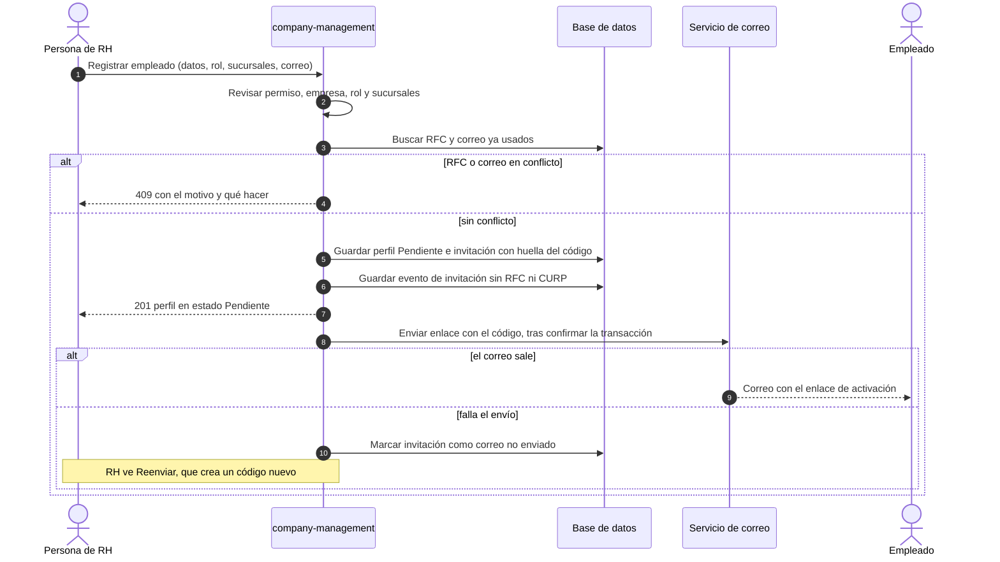
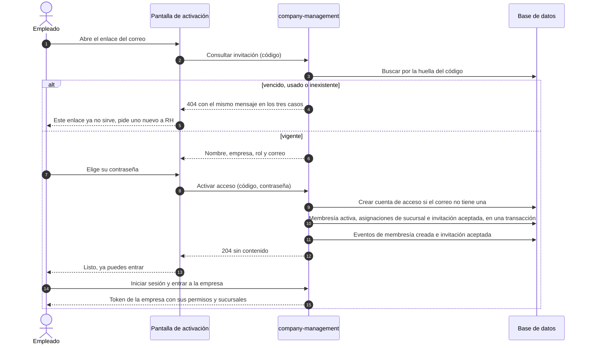
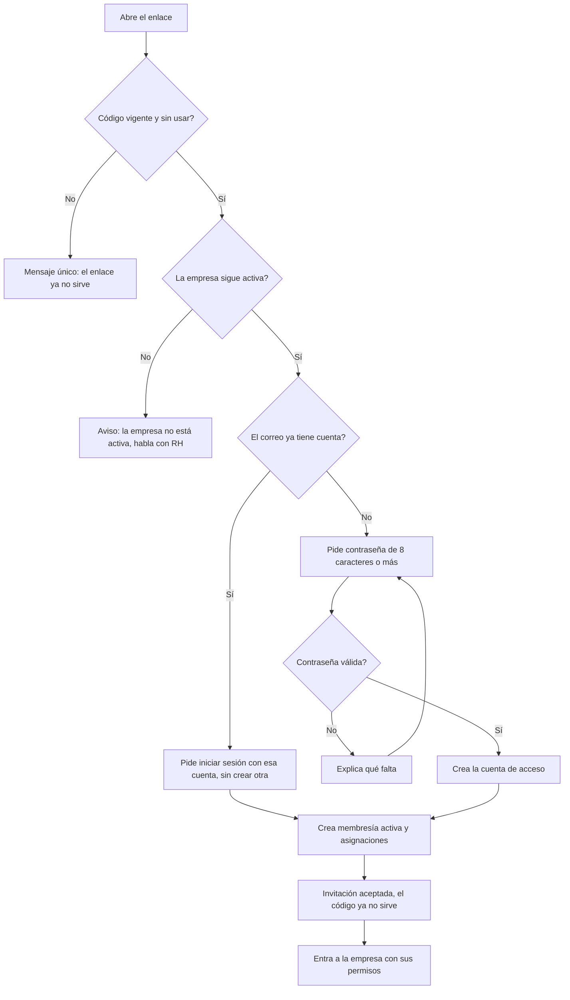
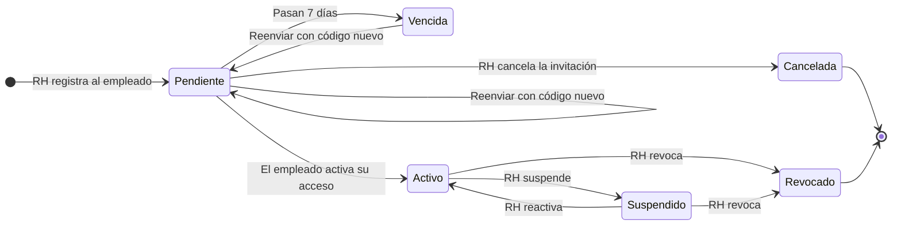

# Roles, membresías y alta de empleados por RH

> Plan del frente de roles y membresías (M0 a M8) y los diagramas del flujo de alta y activación de empleados.
> Los diagramas están en Mermaid, igual que `diagramas-modulo-inventory.md`.

## Qué se construye

- RH registra al empleado: nombre completo, rol, RFC, CURP, correo y sucursales. El empleado no llena nada de eso.
- El sistema envía un enlace por correo. El empleado solo elige su contraseña y queda activo.
- Socios y contadores serán otros tipos de perfil. Hoy solo empleados; el tipo de perfil se guarda como dato.

## Decisiones tomadas

| Tema | Decisión |
|---|---|
| Correo | Lo escribe RH. El enlace va a ese buzón. El empleado no lo cambia y solo elige su contraseña. |
| RFC | Único dentro de cada empresa, no en todo el sistema. |
| Cuenta de acceso | Al activar se crea una cuenta con los datos que RH registró, sin empresa propia, reutilizando el inicio de sesión actual. Si el correo ya tiene cuenta, se pide iniciar sesión en vez de crear otra. |
| Conflictos | Si el RFC o el correo ya pertenecen a otra cuenta, se avisa a RH al registrar (409), no al activar. |
| Código del enlace | Aleatorio de 32 bytes. Solo se guarda su huella. Viaja únicamente en el correo. Vigencia de 7 días. Uso único. |
| Envío | Después de confirmar la transacción. Si falla, la invitación queda «correo no enviado» y RH usa Reenviar, que crea un código nuevo. |
| Enlace inválido | Vencido, usado o inexistente responden igual (404), para no revelar qué códigos existen. |
| Datos personales | RFC y CURP no viajan en los eventos ni en los registros. Solo los ve quien tiene `employees.read`. |
| Permisos | Se añade la familia `employees.*` a `COMPANY_ADMIN`. Nadie otorga más permisos de los que tiene. |

## Etapas

| Etapa | Qué entrega |
|---|---|
| M0 | Estos diagramas y el registro del error de la recuperación de contraseña (ERR-029). |
| M1 | Ver membresías (con filtros y paginación), roles y mis permisos efectivos. |
| M2 | Roles propios de la empresa: crear, editar, desactivar. Los del sistema no se tocan. |
| M3 | Perfil de empleado por RH. Permiso `employees.*`. |
| M4 | Puerto de correo con adaptador SMTP y adaptador de prueba. La recuperación de contraseña pasa a usarlo. |
| M5 | Invitación y activación: consultar, activar, reenviar, cancelar. |
| M6 | Asignaciones por sucursal: listar, crear, cambiar, retirar. |
| M7 | Suspender, reactivar y revocar. |
| M8 | Cierre: suites completas, AsyncAPI al día, bitácora y PR. |

## 1. Alta por RH y envío del enlace

## 2. Activación por el empleado

## 3. Decisiones al abrir el enlace

## 4. Estados de la invitación y de la membresía

`Pendiente`, `Cancelada` y `Vencida` son estados de la invitación. `Activo`, `Suspendido` y `Revocado` son estados de la membresía.
