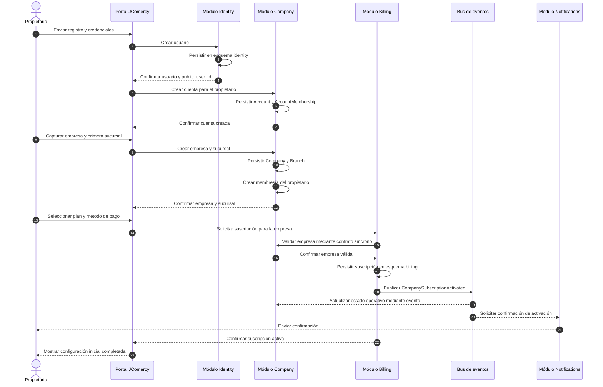
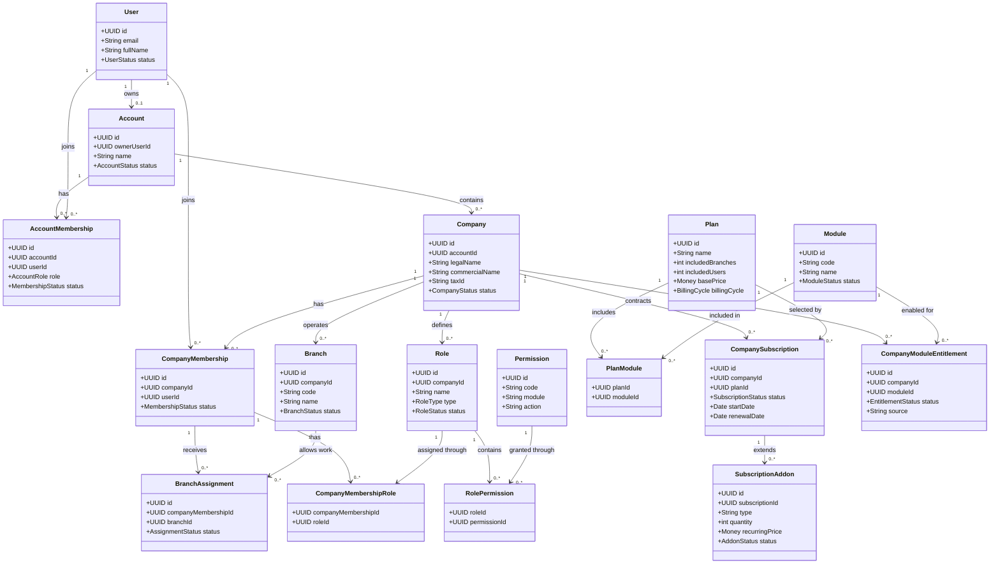
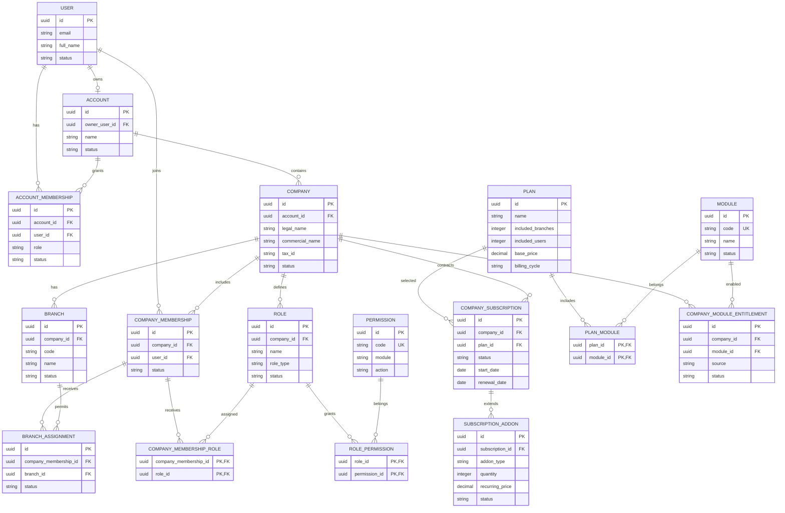

# Software Design Description (SDD)
# Gestión de cuentas, empresas, sucursales y suscripciones

**Identificador:** SDD-JCOMERCY-COMPANY-001  
**Versión:** 0.1  
**Estado:** Borrador para revisión  
**Fecha:** 2026-08-21  
**Sistema:** JComercy  
**Producto:** JComercy Core  
**Documento padre:** SDD-JComercy-Core-001  
**Base normativa:** IEEE 1016-2009

---

## 1. Propósito

Definir el diseño del módulo responsable de administrar la cuenta propietaria, empresas, sucursales, membresías, asignaciones, planes y suscripciones de JComercy.

Este módulo será la base de aislamiento y autorización para todos los módulos empresariales y productos verticales.

## 2. Alcance

### Incluido

- Cuenta administrativa.
- Dueño de cuenta.
- Empresas.
- Sucursales.
- Membresías por empresa.
- Asignación de usuarios a sucursales.
- Planes comerciales.
- Suscripciones por empresa.
- Límites de sucursales.
- Complementos de sucursales adicionales.
- Estado de activación de empresas y sucursales.

### No incluido

- Inventario.
- Ventas.
- Caja.
- Contabilidad.
- Clientes.
- Recursos específicos de cada nicho.
- Facturación fiscal.
- Roles detallados de cada módulo operativo.

## 3. Actores

| Actor | Responsabilidad |
|---|---|
| Dueño de cuenta | Crea y administra sus empresas, suscripciones y operación empresarial |
| Administrador delegado | Gestiona empresas o configuraciones según permisos otorgados |
| Administrador de empresa | Administra una empresa específica |
| Empleado | Trabaja en empresas y sucursales asignadas |
| JCode | Gestiona catálogo de planes, módulos y soporte autorizado |
| Producto vertical | Consulta contexto empresarial y estado de capacidades |

## 4. Modelo conceptual

```text
User
  └── Account (owner)
        ├── AccountMembership
        └── Company
              ├── CompanyMembership
              │     └── BranchAssignment
              ├── Branch
              └── CompanySubscription
                    ├── Plan
                    └── SubscriptionAddon
```

## 5. Entidades de diseño

### 5.1 Account

Agrupa las empresas del propietario inicial.

Reglas:

- Tiene un propietario principal.
- Puede tener administradores delegados.
- No reemplaza a la empresa.
- No mezcla los datos operativos de sus empresas.

### 5.2 Company

Representa un negocio independiente dentro de la cuenta.

Reglas:

- Pertenece a una sola cuenta.
- Tiene su propia suscripción.
- Tiene sus propias sucursales, usuarios, roles y configuración.
- No comparte datos operativos con otras empresas por defecto.

### 5.3 Branch

Representa una unidad operativa de una empresa.

Reglas:

- Pertenece a una sola empresa.
- Consume una unidad de la capacidad de sucursales contratada.
- Puede estar activa, suspendida, en configuración o archivada.
- No tiene una suscripción independiente.

### 5.4 CompanyMembership

Relaciona un usuario con una empresa.

Reglas:

- Los permisos se definen en el contexto de la empresa.
- Un usuario puede pertenecer a varias empresas.
- Los roles personalizados de una empresa no se heredan a otra.

### 5.5 BranchAssignment

Determina en qué sucursales puede trabajar un miembro de la empresa.

Reglas:

- Es necesaria para empleados y administradores delegados operativos.
- Puede incluir una o varias sucursales.
- Puede ser revocada sin eliminar la membresía de empresa.
- No aplica al dueño de cuenta cuando ejerce su alcance global de propietario.

### 5.6 CompanySubscription

Representa el contrato de la empresa con JComercy.

Reglas:

- La suscripción pertenece a la empresa.
- Determina módulos, límites y sucursales incluidas.
- Puede tener complementos adicionales.
- Su estado controla la posibilidad de realizar nuevas operaciones.

### 5.7 Plan

Define las características comerciales disponibles para contratar.

Como mínimo debe determinar:

- Precio y periodicidad.
- Sucursales incluidas.
- Usuarios incluidos.
- Módulos incluidos.
- Límites de almacenamiento.
- Límites de integraciones u operaciones.

### 5.8 SubscriptionAddon

Permite ampliar la capacidad contratada.

El primer complemento será la sucursal adicional.

Ejemplo: un plan con cuatro sucursales incluidas puede contratar tres sucursales adicionales.

## 6. Planes iniciales de referencia

Los precios son pendientes de definición.

| Plan | Sucursales incluidas | Uso esperado |
|---|---:|---|
| Básico | 1 | Negocio con una ubicación |
| Intermedio | Hasta 3 | Negocio pequeño con expansión |
| Pro/Enterprise | Hasta 4 | Negocio con varias sucursales |
| Complemento | Una o más adicionales | Expansión sobre el límite del plan |

La estructura comercial debe ser configurable y no quedar fija dentro del código de los módulos.

## 7. Casos de uso principales

### CU-01 Registrar cuenta

El usuario crea su identidad y se convierte en dueño de una cuenta administrativa.

### CU-02 Crear empresa

El dueño registra una empresa dentro de su cuenta.

La empresa debe poder crearse antes de activar módulos operativos, pero para operar requerirá una suscripción activa.

### CU-03 Contratar suscripción

El dueño selecciona un plan para una empresa.

### CU-04 Crear sucursal

El sistema valida que exista capacidad disponible en el plan o complementos contratados.

### CU-05 Invitar usuario a empresa

El administrador invita a un usuario y le asigna un rol de empresa.

### CU-06 Asignar usuario a sucursal

El administrador asigna una o varias sucursales de trabajo.

### CU-07 Agregar sucursal adicional

El dueño contrata un complemento y posteriormente puede activar nuevas sucursales.

### CU-08 Cambiar de plan

El dueño actualiza el plan. Si el nuevo límite es menor que las sucursales activas, se aplica el periodo de gracia definido por negocio.

## 8. Estados

### Empresa

- `DRAFT`: creada pero no configurada.
- `ACTIVE`: disponible para operación.
- `SUSPENDED`: sin nuevas operaciones por estado comercial o administrativo.
- `ARCHIVED`: fuera de operación, conserva histórico.

### Sucursal

- `SETUP`: en proceso de configuración.
- `ACTIVE`: disponible para operación.
- `SUSPENDED`: sin nuevas operaciones.
- `ARCHIVED`: fuera de operación, conserva histórico.

### Suscripción

- `PENDING`: creada, pendiente de activación.
- `TRIAL`: periodo de prueba.
- `ACTIVE`: vigente.
- `PAST_DUE`: pago pendiente.
- `GRACE_PERIOD`: periodo de regularización.
- `SUSPENDED`: operaciones bloqueadas.
- `CANCELLED`: terminada.
- `EXPIRED`: vencida.

## 9. Autorización

### Dueño de cuenta

Puede administrar y operar las empresas de su cuenta, siempre respetando los módulos incluidos en la suscripción.

### Administrador delegado

Solo puede operar en empresas y sucursales autorizadas mediante membresías, roles y asignaciones.

### Empleado

Solo puede operar en sucursales asignadas y en módulos permitidos por sus roles.

La pertenencia a la cuenta no equivale a una membresía operativa en todas las empresas.

## 10. Reducción de plan

Se aplicará un periodo de gracia de 7 días cuando una empresa reduzca su plan y mantenga más sucursales que las permitidas.

Durante el periodo de gracia:

- Se mantienen las sucursales actuales durante los 7 días.
- No se pueden activar nuevas sucursales.
- Se notifican las sucursales excedentes.
- El dueño puede cancelar sucursales, contratar complementos o cambiar nuevamente de plan.

Al finalizar el periodo, las sucursales excedentes pasan a estado restringido o suspendido, sin eliminar datos históricos.

## 11. Interfaces con otros módulos

Los módulos empresariales y verticales podrán consultar:

- Empresa activa.
- Sucursal activa.
- Usuario y membresía.
- Permisos efectivos.
- Estado de suscripción.
- Módulos habilitados.
- Capacidad disponible de sucursales.

No podrán modificar directamente las entidades de este módulo.

Tampoco podrán consultar directamente sus tablas. El acceso se realizará mediante contratos síncronos definidos por el módulo o mediante eventos asíncronos publicados por este. El módulo de gestión empresarial conserva la propiedad exclusiva de sus esquemas, tablas y reglas de consistencia.

Esta regla aplica igualmente a los módulos de inventario, ventas, caja, contabilidad, fiscalidad, integraciones y productos verticales: cada uno será propietario de sus datos y expondrá únicamente los contratos necesarios para colaborar con los demás.

### 11.1 Diagrama de secuencia: alta inicial del propietario

El siguiente flujo representa el registro inicial del propietario, la creación de la cuenta, la empresa, la primera sucursal y la activación de la suscripción. El Portal coordina la operación, pero no persiste directamente en los esquemas de los módulos.



Reglas observables en el flujo:

- `Identity`, `Company` y `Billing` escriben únicamente en sus propios esquemas.
- `Billing` valida la empresa mediante un contrato, nunca consultando sus tablas directamente.
- La activación se comunica mediante el evento `CompanySubscriptionActivated`.
- El `public_user_id` es el identificador que puede circular entre módulos y contratos externos.

## 12. Trazabilidad

| Necesidad | Diseño |
|---|---|
| Propietario inicial | `Account` y dueño principal |
| Varias empresas | Relación `Account` a `Company` |
| Suscripción por empresa | `CompanySubscription` |
| Planes con sucursales incluidas | `Plan` |
| Sucursales adicionales | `SubscriptionAddon` |
| Empleados por sucursal | `BranchAssignment` |
| Roles por empresa | `CompanyMembership` y roles empresariales |
| Aislamiento | Contexto de empresa y sucursal |
| Propiedad de datos | Esquema propio por módulo y contratos síncronos/asíncronos |

## 13. Decisiones resueltas

1. **Periodo de gracia:** será de 7 días. Durante este periodo el cliente podrá completar la configuración inicial, registrar su personal y regularizar el pago.

2. **Suscripción `PAST_DUE`:** se recomienda mantener una ventana operativa de 7 días. Durante ella se permitirán las operaciones esenciales y la configuración inicial, pero se bloquearán nuevas sucursales, módulos, complementos y usuarios que excedan el límite contratado. Se mostrarán avisos de pago pendiente y se conservará el acceso del propietario y administradores autorizados.

   Al terminar la ventana, la empresa pasará a estado `SUSPENDED`: no podrá crear nuevas operaciones, pero conservará acceso de consulta, descarga de información y regularización del pago. La reactivación deberá restaurar las operaciones sin eliminar datos históricos.

3. **Creación inicial:** la primera empresa y su sucursal matriz se crearán automáticamente durante el registro, pero permanecerán en estado de configuración hasta que el propietario complete los datos obligatorios de la empresa y de la sucursal.

4. **Suscripciones históricas:** una empresa podrá conservar múltiples suscripciones históricas, pero solo tendrá una suscripción activa por cada momento. Los cambios de plan generarán una nueva versión o registro de suscripción, manteniendo el historial de facturación, fechas y estado anterior.

5. **Usuarios incluidos:** el módulo de Billing será responsable de controlar los límites y el consumo. Se contabilizarán usuarios de plataforma activos, es decir, personas con credenciales habilitadas; los empleados registrados en Personal y Nómina sin acceso al sistema no consumirán este límite. Company Management será responsable de membresías y asignaciones, mientras Billing determinará si existe capacidad disponible.

## 14. Criterio de aprobación

**Estado: APROBADO por el propietario del proyecto.**

El SDD queda aprobado para pasar al modelado relacional, con los siguientes elementos validados:

- [x] Entidades y relaciones.
- [x] Estados.
- [x] Reglas de suscripción.
- [x] Alcances de propietario y administradores.
- [x] Reglas de reducción de plan.
- [x] Contratos de consulta para módulos dependientes.
- [x] Política de gracia y suspensión por pago vencido.
- [x] Control de usuarios de plataforma incluidos en el plan.

La aprobación no autoriza todavía la implementación de código ni la creación de migraciones. La siguiente fase consiste en definir el modelo relacional interno del esquema propietario de este módulo.

## 15. Diagrama UML de clases



## 16. Diagrama entidad–relación conceptual


