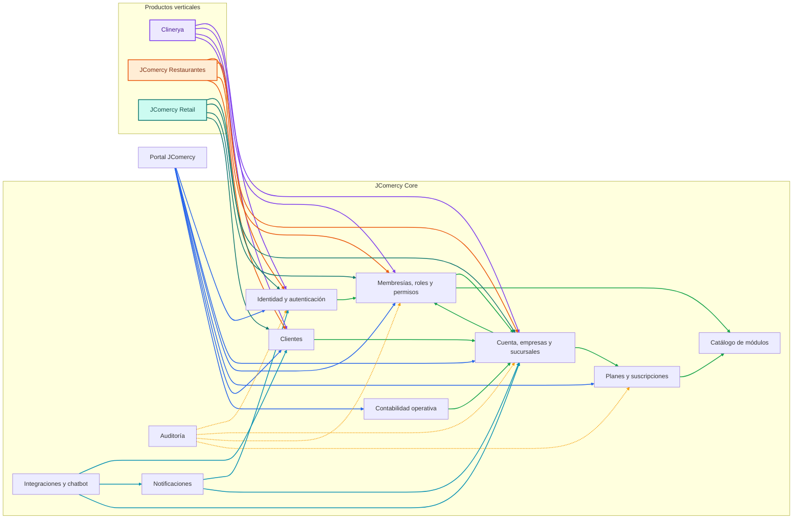

# Software Design Description (SDD)
# JComercy Core

**Identificador:** SDD-JCOMERCY-CORE-001  
**Versión:** 0.1  
**Estado:** Borrador para revisión  
**Fecha:** 2026-08-21  
**Sistema:** JComercy  
**Producto:** JComercy Core  
**Base normativa:** IEEE 1016-2009 — Software Design Descriptions

---

## Control del documento

| Campo | Valor |
|---|---|
| Autor | JCode |
| Revisores | Pendiente de asignación |
| Aprobador | Pendiente de asignación |
| Clasificación | Diseño interno de producto |
| Repositorio | JComercy |
| Documento relacionado | `modelo-datos-empresas.md` |
| Documento relacionado | `modelo-autorizacion-jcomercy.md` |
| Documento relacionado | `arquitectura-jcomercy-core.md` |

## Historial de cambios

| Versión | Fecha | Descripción | Autor |
|---|---|---|---|
| 0.1 | 2026-08-21 | Creación del SDD base para JComercy Core | JCode |

## 1. Propósito y alcance

Este documento describe el diseño de alto nivel de JComercy Core, la plataforma empresarial multiempresa y multisucursal sobre la que se construirán productos verticales como Clinerya, restaurantes, retail y otros nichos.

El documento se elabora antes de la implementación. No define todavía clases, código fuente, sentencias SQL ni migraciones Flyway definitivas.

El alcance inicial incluye:

- Identidad y usuario propietario.
- Cuenta administrativa.
- Empresas.
- Sucursales.
- Membresías y asignaciones.
- Roles y permisos.
- Planes y suscripciones empresariales.
- Capacidad de sucursales incluida y adicional.
- Habilitación de módulos.
- Contabilidad operativa.
- Aislamiento entre empresas y sucursales.

Fuera del alcance inicial:

- Expediente clínico.
- Pacientes y tratamientos clínicos.
- Recursos específicos de cada nicho.
- Implementación de facturación fiscal.
- Cumplimiento tributario específico de un país.
- Código de aplicación.
- Migraciones de base de datos.

## 2. Stakeholders y preocupaciones de diseño

| Stakeholder | Preocupaciones |
|---|---|
| Dueño de cuenta | Crear empresas, contratar planes y operar sus negocios |
| Administrador delegado | Gestionar empresas o módulos con permisos asignados |
| Empleado | Trabajar únicamente en sucursales autorizadas |
| Contador/RH/Socio | Acceder a funciones específicas según su rol |
| JCode | Administrar la plataforma, planes y soporte autorizado |
| Producto vertical | Utilizar empresas, sucursales, clientes y permisos sin apropiarse del núcleo |
| Cliente final | Aislamiento, disponibilidad y seguridad de sus datos |

## 3. Principios de diseño

- El usuario que se registra inicialmente es el dueño de la cuenta.
- El dueño puede operar sus empresas y delegar funciones.
- Una cuenta puede agrupar varias empresas.
- Una empresa tiene su propia suscripción.
- Un plan define la cantidad de sucursales incluidas.
- Las sucursales adicionales se contratan como complementos.
- Una sucursal es el límite operativo normal.
- Los empleados deben ser asignados explícitamente a sus sucursales.
- La pertenencia a una cuenta no otorga acceso operativo automático a todas las empresas.
- La consulta cruzada entre sucursales es excepcional, explícita y auditable.
- Los recursos específicos pertenecen a cada producto vertical.
- Clinerya no forma parte del núcleo genérico.
- Todas las operaciones deben validar autorización en backend.

## 4. Vista de contexto del sistema

```text
Usuario propietario o delegado
             │
             ▼
      JComercy Core
        │      │
        │      ├── Suscripciones y planes
        │      ├── Empresas y sucursales
        │      ├── Usuarios, roles y permisos
        │      └── Clientes y módulos habilitados
        │
        ├── Clinerya
        ├── JComercy Restaurantes
        ├── JComercy Retail
        └── Otros productos verticales
```

JComercy Core proporciona el contexto empresarial y los productos verticales proporcionan las capacidades propias de cada industria.

## 5. Vista de composición

Los componentes iniciales de JComercy Core son:

1. Identidad y autenticación.
2. Cuenta administrativa.
3. Empresas.
4. Sucursales.
5. Membresías y asignaciones.
6. Roles y permisos.
7. Suscripciones y planes.
8. Catálogo de módulos.
9. Clientes.
10. Contabilidad operativa.
11. Auditoría.
12. Notificaciones.
13. Integraciones.

## 5.1 Diagrama de componentes de JComercy Core



El núcleo proporciona contexto empresarial, identidad, autorización, suscripciones y capacidades transversales. Cada producto vertical consume estos contratos, pero conserva sus propias entidades de negocio, recursos y reglas operativas.

## 6. Vista de información

```text
User
  └── Account
        ├── AccountMembership
        └── Company
              ├── CompanyMembership
              │     └── BranchAssignment
              ├── Branch
              ├── CompanySubscription
              │     ├── Plan
              │     └── SubscriptionAddon
              ├── CompanyModuleEntitlement
              └── Customer
```

Las entidades y sus reglas detalladas se describen en [modelo-datos-empresas.md](../modelo-datos-empresas.md).

## 7. Vista de seguridad y autorización

El acceso efectivo se calcula a partir de:

```text
Usuario
 + Membresía
 + Rol
 + Permiso
 + Empresa
 + Sucursal asignada
 + Suscripción activa
 + Módulo habilitado
```

El dueño de la cuenta tiene alcance de propietario sobre sus empresas y puede operar sus negocios. Los administradores delegados y empleados requieren permisos y asignaciones explícitas.

Las reglas detalladas se describen en [modelo-autorizacion-jcomercy.md](../modelo-autorizacion-jcomercy.md).

## 8. Vista de suscripciones

La suscripción pertenece a la empresa.

```text
Company
  └── CompanySubscription
        ├── Plan
        ├── IncludedBranchLimit
        ├── SubscriptionAddon
        └── CompanyModuleEntitlement
```

Ejemplo de planes:

| Plan | Sucursales incluidas | Expansión |
|---|---:|---|
| Básico | 1 | Cambio de plan para crecer |
| Intermedio | 3 | Incluidas en el paquete |
| Pro/Enterprise | 4 | Sucursales adicionales con cargo recurrente |

## 9. Vista de aislamiento

El aislamiento se aplica en dos niveles:

1. **Empresa:** una empresa no puede consultar ni modificar datos de otra empresa.
2. **Sucursal:** una sucursal no puede consultar ni modificar datos de otra sucursal por defecto.

Una consulta cruzada autorizada, como verificar existencias en otra sucursal, no permite vender, cobrar ni modificar directamente los datos de esa otra sucursal.

### 9.1 Propiedad de datos por módulo

Cada módulo tendrá un esquema de base de datos propio y será el único propietario de sus tablas y registros. Ningún módulo podrá consultar, insertar, actualizar o eliminar directamente información perteneciente al esquema de otro módulo.

La comunicación entre módulos se realizará exclusivamente mediante contratos explícitos:

- **Síncrona:** APIs internas, interfaces de aplicación o consultas de servicio para operaciones que requieran respuesta inmediata.
- **Asíncrona:** eventos de dominio o integración para notificar cambios que puedan procesarse posteriormente.

Las referencias entre módulos se manejarán mediante identificadores públicos o referencias contractuales, sin crear dependencias directas sobre las tablas del módulo propietario. Cada módulo validará sus propias reglas de negocio y conservará la responsabilidad sobre la consistencia de sus datos.

## 10. Vista de interfaces y contratos

Los productos verticales consumirán contratos de JComercy Core para:

- Consultar empresa y sucursal.
- Validar membresías y permisos.
- Consultar clientes autorizados.
- Consultar estado de suscripción.
- Validar módulos habilitados.
- Recibir eventos de activación o suspensión.

Los productos verticales no compartirán entidades de persistencia con JComercy Core.

## 11. Vista de despliegue

La primera implementación se diseñará como monolito modular. Cada módulo tendrá límites claros y un esquema de base de datos propio, aunque inicialmente comparta el mismo despliegue y motor de base de datos. Compartir el motor no implica compartir tablas ni permitir acceso directo entre esquemas.

La separación física en servicios independientes queda fuera del alcance inicial.

## 12. Vista de decisiones de diseño

### 12.1 Cuenta administrativa

Se incorpora para representar al usuario propietario y agrupar sus empresas. No sustituye a la empresa ni recibe automáticamente todos los permisos operativos.

### 12.2 Suscripción empresarial

La suscripción se asigna a la empresa porque el paquete comercial y la facturación corresponden al negocio. Las sucursales adicionales se manejan mediante límites y complementos.

### 12.3 Recursos por producto vertical

JComercy Core no modela recursos genéricos. Clinerya, restaurantes y otros productos definirán sus propios espacios, atributos y reglas.

## 13. Trazabilidad de requisitos

| Requisito | Elementos de diseño |
|---|---|
| Usuario con varias empresas | `Account`, `Company`, `AccountMembership` |
| Suscripción por empresa | `CompanySubscription`, `Plan` |
| Límite de sucursales | `IncludedBranchLimit`, `SubscriptionAddon` |
| Empleados por sucursal | `CompanyMembership`, `BranchAssignment` |
| Roles personalizados | `Role`, `Permission` |
| Aislamiento entre sucursales | Alcance de autorización y contexto operativo |
| Integración con Clinerya | Interfaces y contratos de contexto |
| Propiedad de datos por módulo | Esquema propio y comunicación mediante contratos |

## 14. Decisiones pendientes

1. Si una cuenta puede tener más de un propietario.
2. Si el dueño puede transferir la propiedad.
3. Si un usuario puede tener varios roles en una empresa.
4. Si los roles personalizados se definen a nivel de cuenta, empresa o ambos.
5. Qué ocurre al reducir un plan con más sucursales activas que el nuevo límite.
6. Qué módulos se incluyen en cada plan.
7. Qué datos puede consultar un administrador de cuenta sin membresía operativa.

## 15. Criterios de aprobación del diseño

El SDD podrá pasar a diseño detallado cuando:

- Las decisiones pendientes tengan una resolución.
- El modelo de entidades sea aprobado.
- Los límites de autorización sean verificables.
- El contrato con productos verticales esté definido.
- El catálogo inicial de planes y módulos esté acordado.
- Se confirme la estrategia de esquemas y migraciones Flyway.
